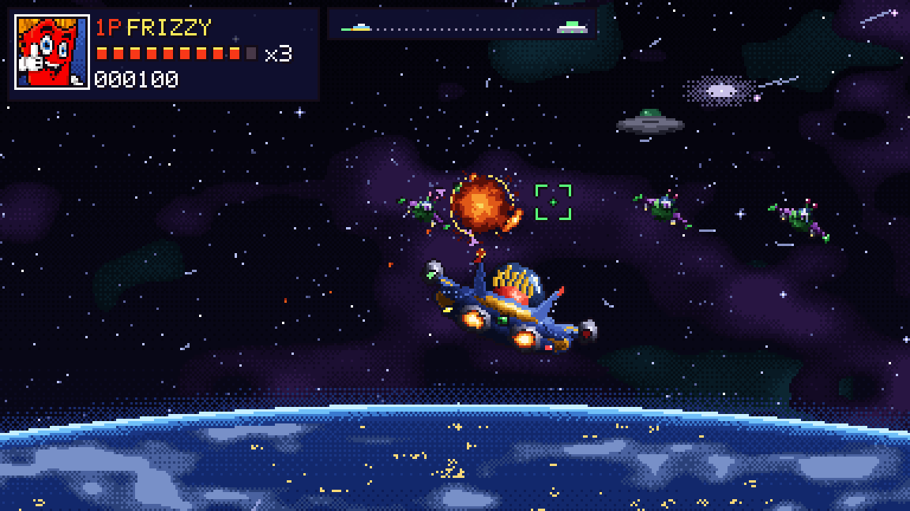
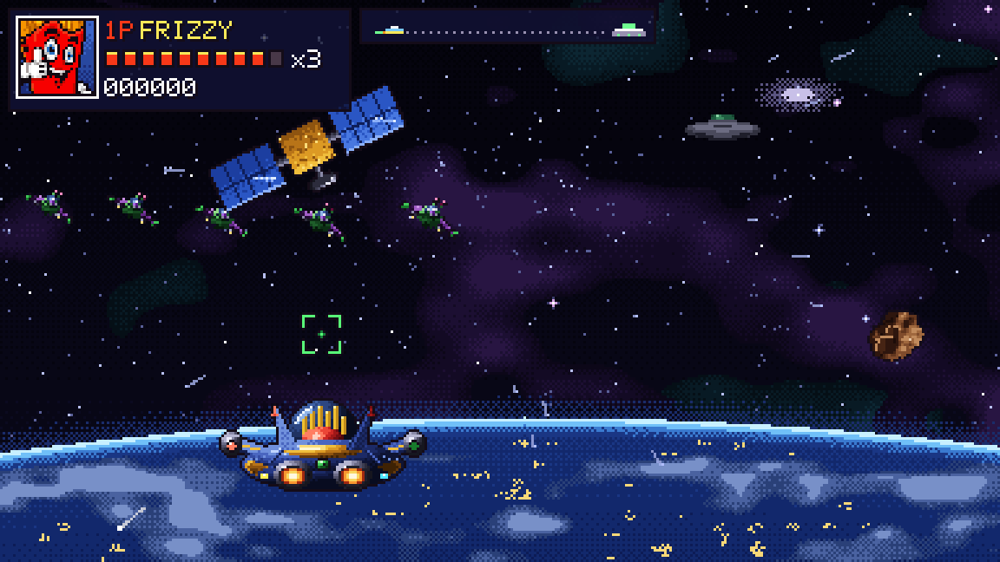
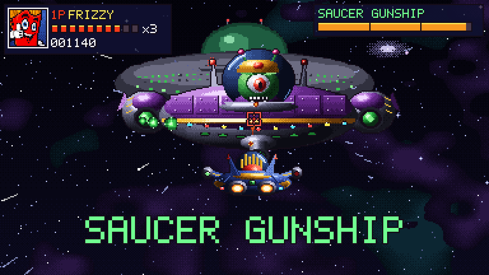

# The MisAdventures of Frizzy and The Food Crew: Demo

An SNES-style beat 'em up. Aliens have abducted Frizzy's friends from the Food Shack, and Frizzy has to fight through Fry Street to get them back, then chase their saucer into space.

This demo has the first two stages:

- **Stage 1: Fry Street.** Brawl down the street to Warehouse 13 and the boss fight with Captain Grub.
- **Stage 2: Escape Velocity.** Steal Grub's scout ship and chase the saucer up through orbit, Star Fox style, past alien fighters, gunships, mines and space junk, to the mothership and the Saucer Gunship guarding its hangar.

## [⬇ Download for Windows (zip, 44 MB)](https://github.com/nnaja1031/FoodShack-Demo/raw/main/FrizzyAndTheFoodCrew-Demo-Windows.zip)

1. Unzip the download.
2. Double-click `FrizzyAndTheFoodCrew.exe`.
3. If Windows says "Windows protected your PC", click **More info** and then **Run anyway**. The demo isn't code-signed yet.

Needs Windows 10 or 11 (64-bit). A gamepad is optional.

## Controls

| Stage 1 | Keyboard | Gamepad |
|---|---|---|
| Move | W A S D | D-pad or left stick |
| Attack | J | Y |
| Jump | K | B |
| Pause | Esc | Start |

| Stage 2 | Keyboard | Gamepad |
|---|---|---|
| Fly | W A S D | D-pad or left stick |
| Shoot (hold) | J | Y |
| Barrel roll (bats plasma back) | K | B |
| Pause | Esc | Start |

Press Esc to skip a cutscene. Alt+Enter switches between full screen and a window.

## Screenshots

