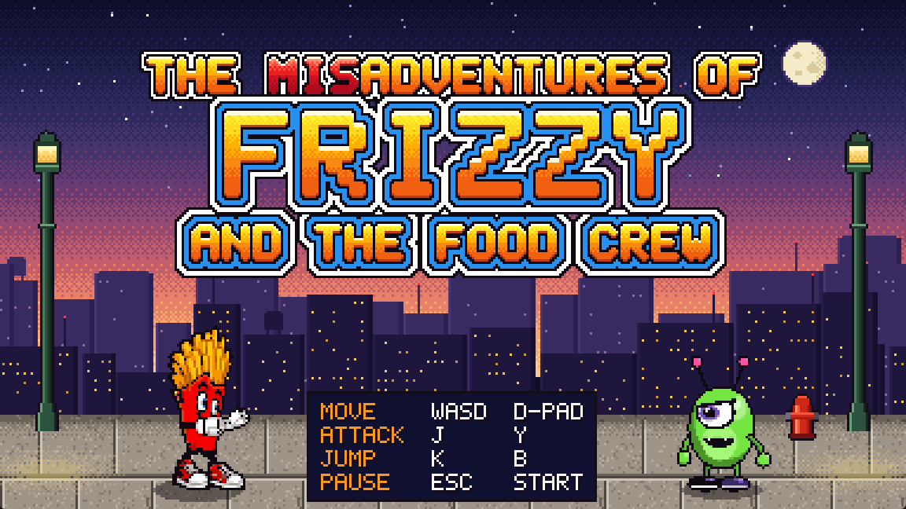
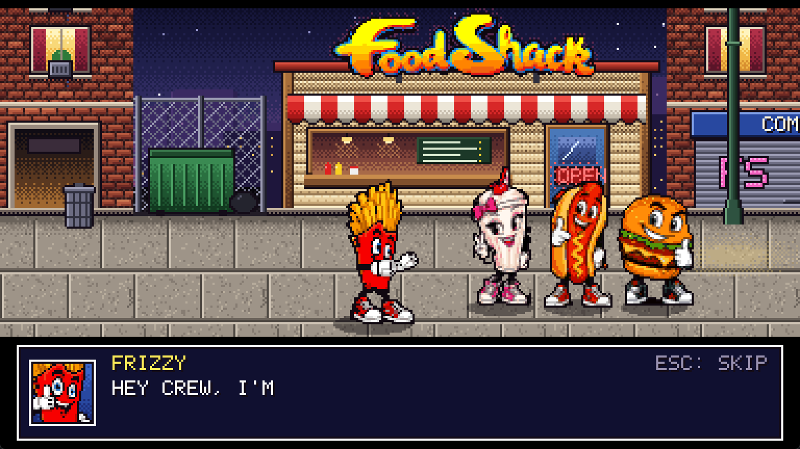
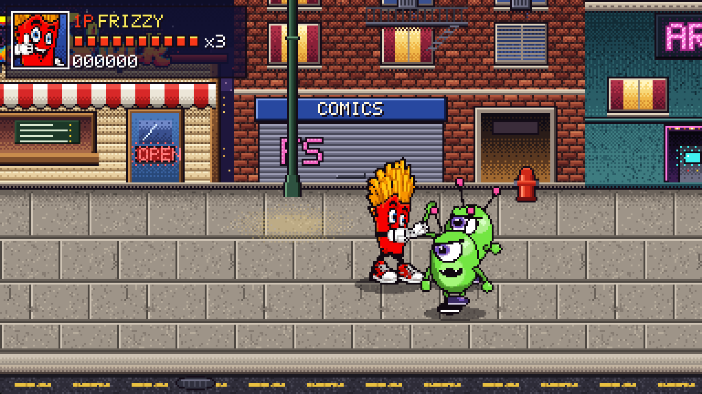

# The MisAdventures of Frizzy and The Food Crew: Demo

An SNES-style beat 'em up. Aliens have abducted Frizzy's friends from the Food Shack, and Frizzy has to fight through Fry Street to get them back.

This demo is Stage 1: Fry Street, Warehouse 13, and the boss fight with Captain Grub.

## [⬇ Download for Windows (zip, 42 MB)](https://github.com/nnaja1031/FoodShack-Demo/raw/main/FrizzyAndTheFoodCrew-Demo-Windows.zip)

1. Unzip the download.
2. Double-click `FrizzyAndTheFoodCrew.exe`.
3. If Windows says "Windows protected your PC", click **More info** and then **Run anyway**. The demo isn't code-signed yet.

Needs Windows 10 or 11 (64-bit). A gamepad is optional.

## Controls

| Action | Keyboard | Gamepad |
|---|---|---|
| Move | W A S D | D-pad or left stick |
| Attack | J | Y |
| Jump | K | B |
| Pause | Esc | Start |

Press Esc to skip a cutscene. Alt+Enter switches between full screen and a window.

## Screenshots

