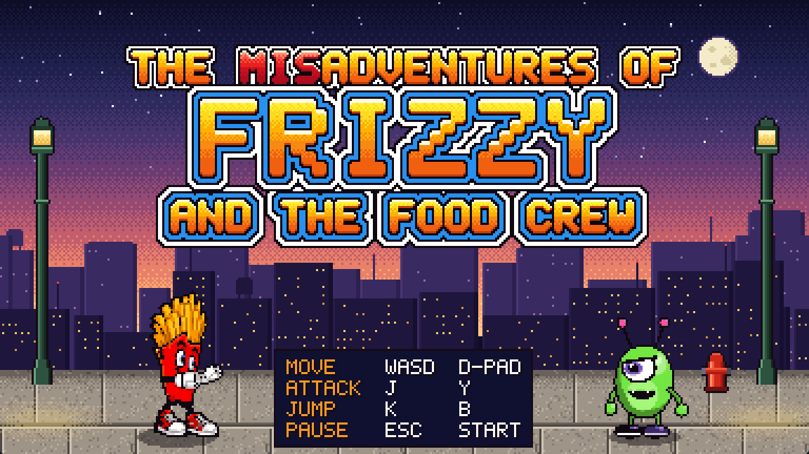
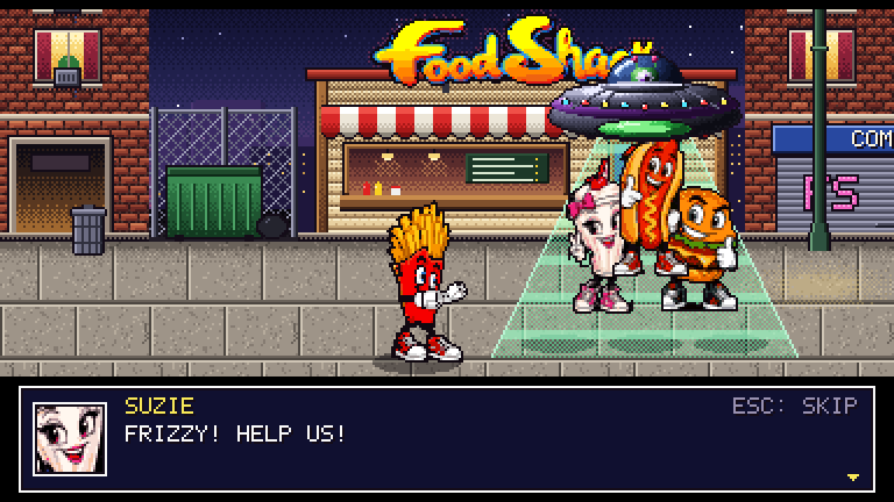
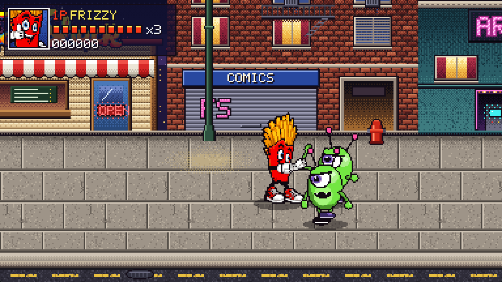
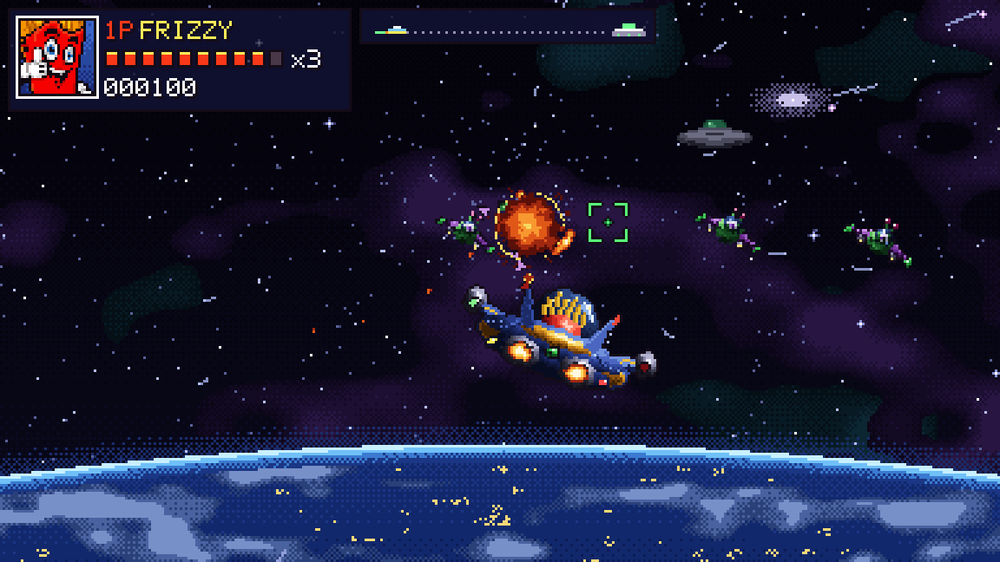
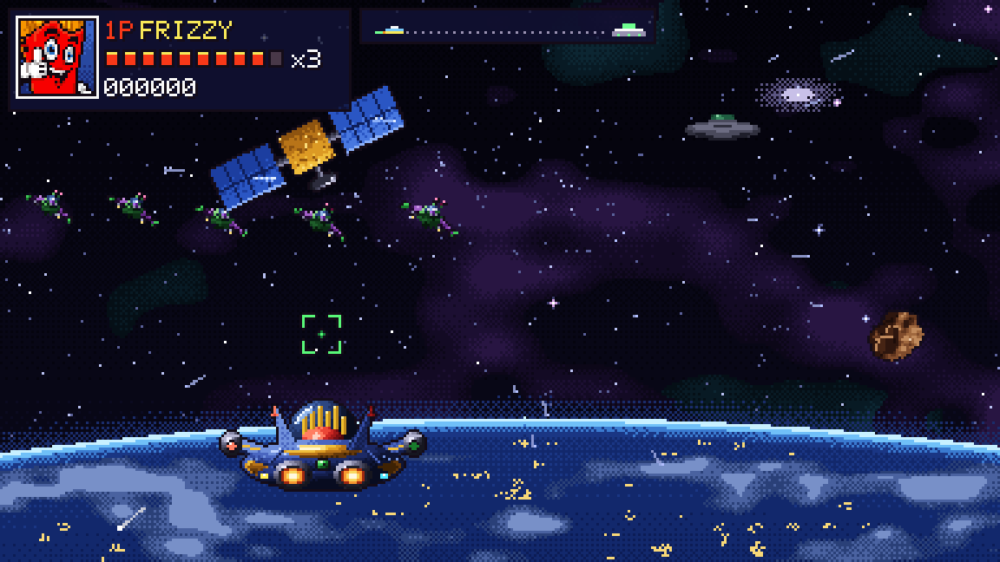
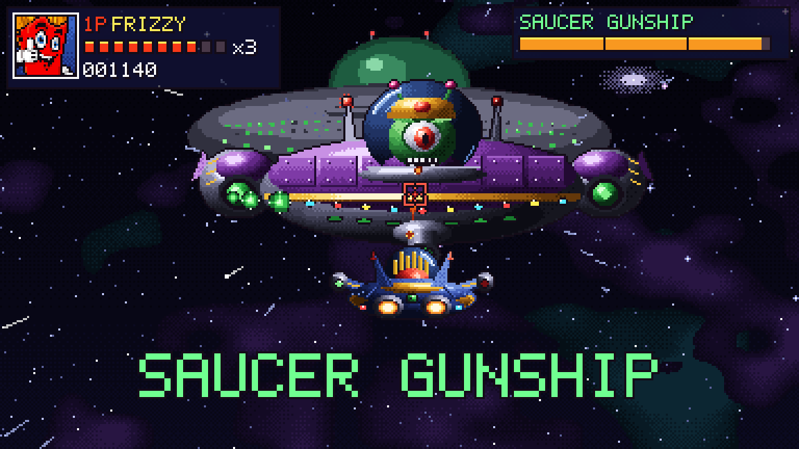
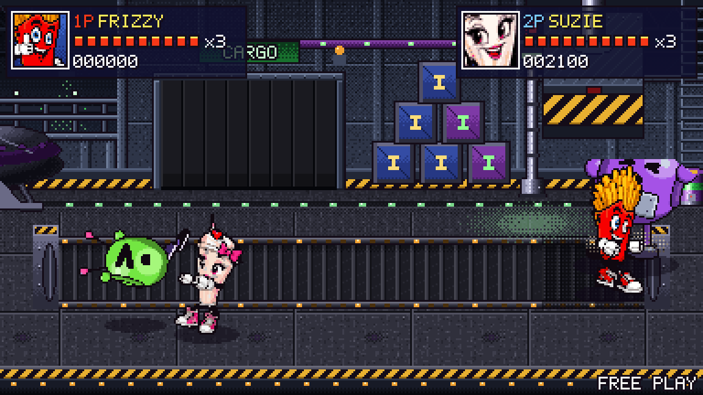
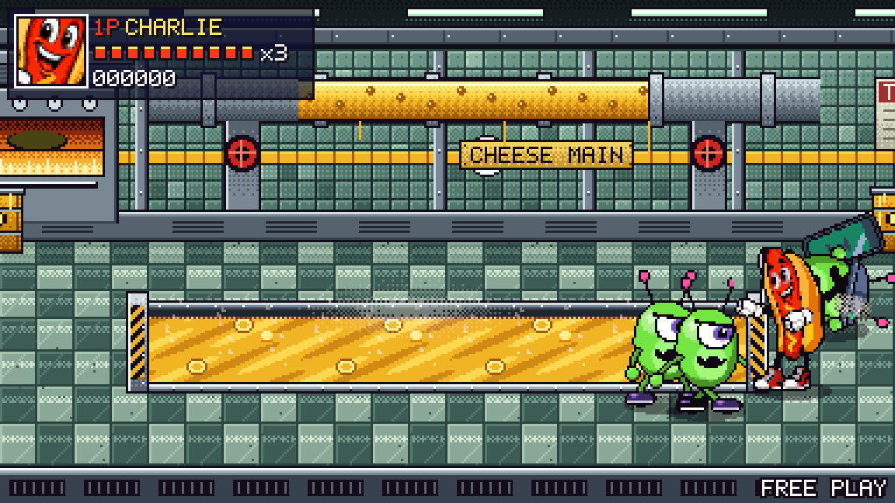
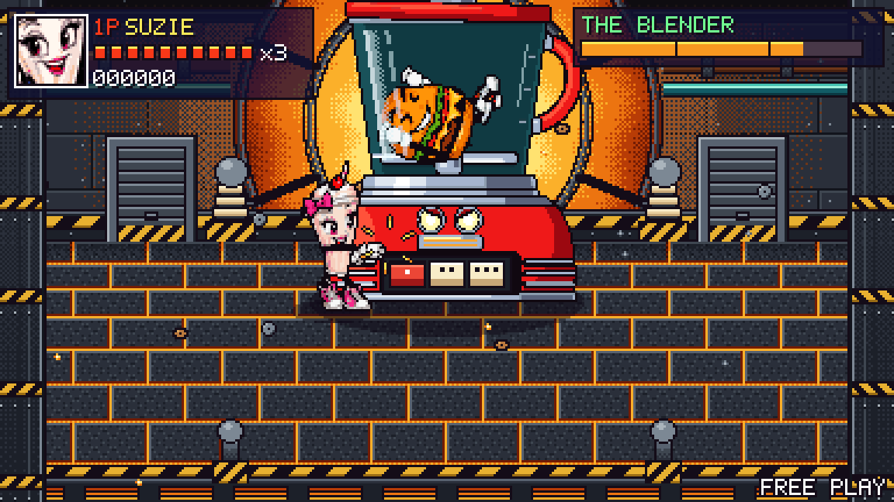
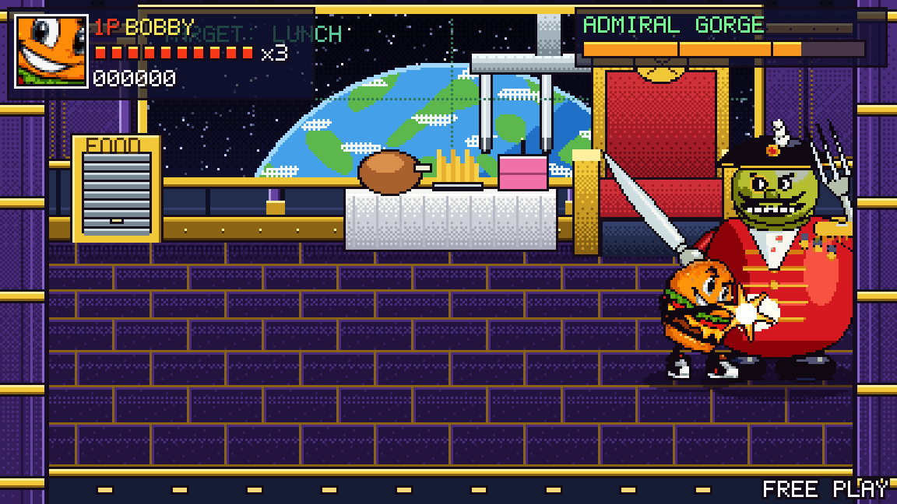

# The MisAdventures of Frizzy and The Food Crew: Demo

An SNES-style beat 'em up. Aliens have abducted Charlie and Bobby from the Food Shack, and Frizzy and Suzie have to fight through Fry Street, chase the saucer into space and take the mothership apart deck by deck to get them back.

This demo is the whole game so far, all six stages:

- **Stage 1: Fry Street.** Brawl down the street to Warehouse 13 and the boss fight with Captain Grub.
- **Stage 2: Escape Velocity.** Steal Grub's scout ship and chase the saucer up through orbit, Star Fox style, past alien fighters, gunships, mines and space junk, to the mothership and the Saucer Gunship guarding its hangar.
- **Stage 3: Docking Bay.** Land in the mothership's hangar, dodge the cranes, ride the cargo lift and take on Quartermaster Kale. Rescue Charlie.
- **Stage 4: Galley Labs.** The aliens' food labs: molten cheese vats, freeze rays, a walk-in freezer and Dr. Fondue's cheese monster.
- **Stage 5: Engine Core.** Low gravity: knock the aliens up and keep them in the air. Vents, power arcs, floating sentries and The Blender, with Bobby trapped in its jar.
- **Stage 6: The Bridge.** An old foe in the officers' mess, Admiral Gorge on the bridge (grab the food before he eats it to heal), then a race against the self-destruct.

Play as Frizzy or Suzie. Charlie and Bobby join the crew in the stage after you rescue them.

## [⬇ Download for Windows (zip, 67 MB)](https://github.com/nnaja1031/FoodShack-Demo/raw/main/FrizzyAndTheFoodCrew-Demo-Windows.zip)

1. Unzip the download.
2. Double-click `FrizzyAndTheFoodCrew.exe`.
3. If Windows says "Windows protected your PC", click **More info** and then **Run anyway**. The demo isn't code-signed yet.

Needs Windows 10 or 11 (64-bit). A gamepad is optional.

## What's new since the last demo

- Stages 3 to 6, and the ending.
- Suzie, Charlie and Bobby, each with their own weapon and moves.
- Two-player co-op on one keyboard or two gamepads.
- Grabs and throws (walk into a dazed alien to grab it), and a back attack: turn round on an alien behind you and attack.
- A high score table: put your initials in when your run ends.
- Food you don't need for health, and a weapon when you've already got one, are worth bonus points.
- Leave the title screen alone and the game plays itself.

## Controls

| One player | Keyboard | Gamepad |
|---|---|---|
| Move | W A S D or the arrow keys | D-pad or left stick |
| Attack | J | Y |
| Jump | K or Space | B |
| Pause | Esc | Start |

Walk into a dazed alien to grab it: Attack knees it, Attack while pushing a direction throws it.

| Stage 2 | Keyboard | Gamepad |
|---|---|---|
| Fly | W A S D | D-pad or left stick |
| Shoot (hold) | J | Y |
| Barrel roll (bats plasma back) | K | B |
| Pause | Esc | Start |

**Two players:** on the hero select, player 2 presses **2** on the keyboard, or Start on a second gamepad, to join. Then the keyboard is split:

| | Player 1 | Player 2 |
|---|---|---|
| Move | W A S D | Arrow keys |
| Attack | J | Number pad 1 |
| Jump | K or Space | Number pad 2 or 0 |

With two gamepads, the first one plugged in is player 1's and the second is player 2's. Press Esc to skip a cutscene. Alt+Enter switches between full screen and a window.

## Screenshots

